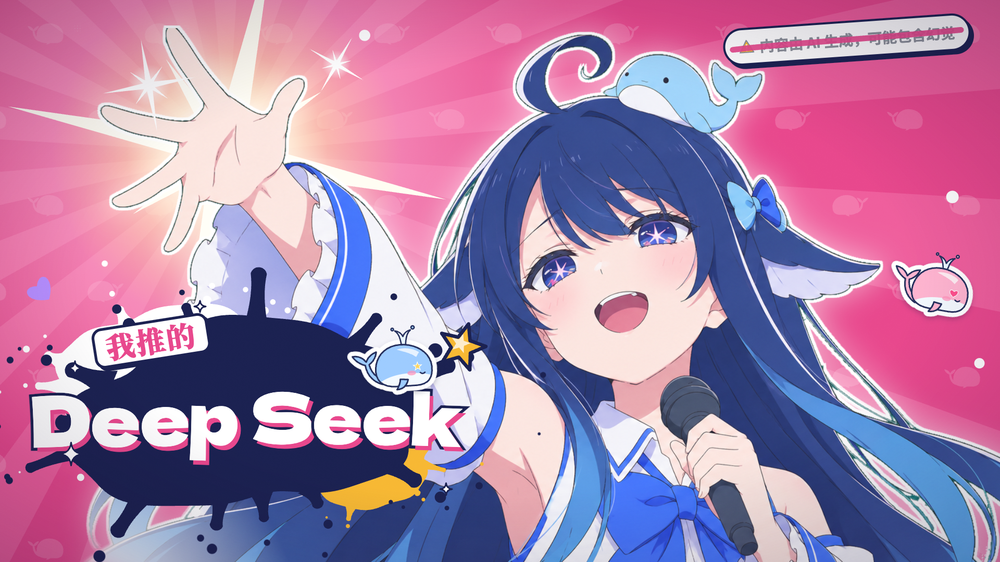

# deepseek-idol



粉丝向二创 MV：让 DeepSeek（鲸鱼娘形象）出演 YOASOBI「アイドル」。
1920×1080 @ 30fps。

**[观看成品 MV：【我推的DeepSeek】アイドル/MV（B 站 BV1CNJv6sEez）](https://www.bilibili.com/video/BV1CNJv6sEez)**

也可在 [Releases](https://github.com/Flutter-Misdreavus/deepseek-idol/releases) 下载成片 `final.mp4`。

> ⚠️ **声明**：本项目为非营利粉丝二次创作。歌曲《アイドル》版权归 YOASOBI / Sony Music 所有；
> Live2D 模型「DS鲸鱼娘」由 B 站 @氵六青 无偿分享（CC BY-NC-SA 4.0，形象版权 @上善无形 与 @ZipZipPin）。
> **本仓库不包含上述任何版权素材**，请按下文自行准备，并遵守各自的授权条款，请勿商用。

## 目录结构

| 目录 | 说明 |
|---|---|
| `mv/` | Remotion 4 主工程。`src/scenes/S0–S9.tsx` 按歌曲分段，`timeline.ts` 按节拍切镜头，`lib/` 为共享动效组件（Kinetic 歌词、Whale、ChatWindow、CRT Monitor 等），`src/data/` 存歌词/节拍数据，`public/` 为渲染输入素材 |
| `live2d-render/` | 用 puppeteer + pixi-live2d-display + Cubism Core 把 Live2D 模型按 `clips/*.js` 脚本离线渲染成透明 PNG 序列，供 Remotion 的 `L2D` 组件播放 |
| `tools/` | Python / shell 工具链：音频节拍分析、抠图、贴纸描边、歌词构建、抽帧校样、成片质检、批量生成角色图、分段预览 |
| `gen/` | AI 角色图的 prompt 记录（`prompts.md`）与批量任务（`jobs_m1.tsv`）；生成的图片**不入库**（见下） |
| `assets/` | 原始素材的约定存放位置（**内容不入库**） |

## 自行准备的素材（均未入库）

1. **歌曲音频**：将《アイドル》音频放到 `mv/public/audio/song.mp3`。
2. **Live2D 模型**：从原作者处获取「DS鲸鱼娘」模型，放入 `assets/music/DS鲸鱼娘/`；
   并从 [Live2D 官网](https://www.live2d.com/)下载 Cubism SDK for Web，
   将 `live2dcubismcore.min.js` 放入 `live2d-render/vendor/`。
3. **歌词数据**：`mv/src/data/lyrics.json` 由 `tools/build_lyrics.py` 生成（需要日文原词，请自行准备）；
   `mv/src/data/beats.json` 由 `tools/analyze_audio.py` 对歌曲分析生成。
4. **角色立绘**：`mv/public/img/` 与 `gen/` 下的图片基于「DS鲸鱼娘」形象生成，属演绎作品，不入库。
   可参照 `gen/prompts.md` 与 `gen/jobs_m1.tsv` 用 `tools/gen_image.sh` / `gen_batch.sh` 自行重新生成。

## 运行

```bash
# Live2D 渲染帧（需要本机 Chrome；路径见 live2d-render/render.js，按需修改）
cd live2d-render && npm install
node render.js <clip名>

# MV 工程
cd mv && npm install
npx tsc --noEmit -p .          # 类型检查
npx remotion studio            # 可视化预览

# 工具链（Python 依赖：librosa / yt-dlp / pyobjc 等）
tools/preview.sh <场景名> <from> <to>   # 分段预览
```

## License

本仓库中的**原创代码与文本**以 [MIT](LICENSE) 协议发布。
上述第三方歌曲、模型等素材不在本协议覆盖范围内，权利归原作者所有。
